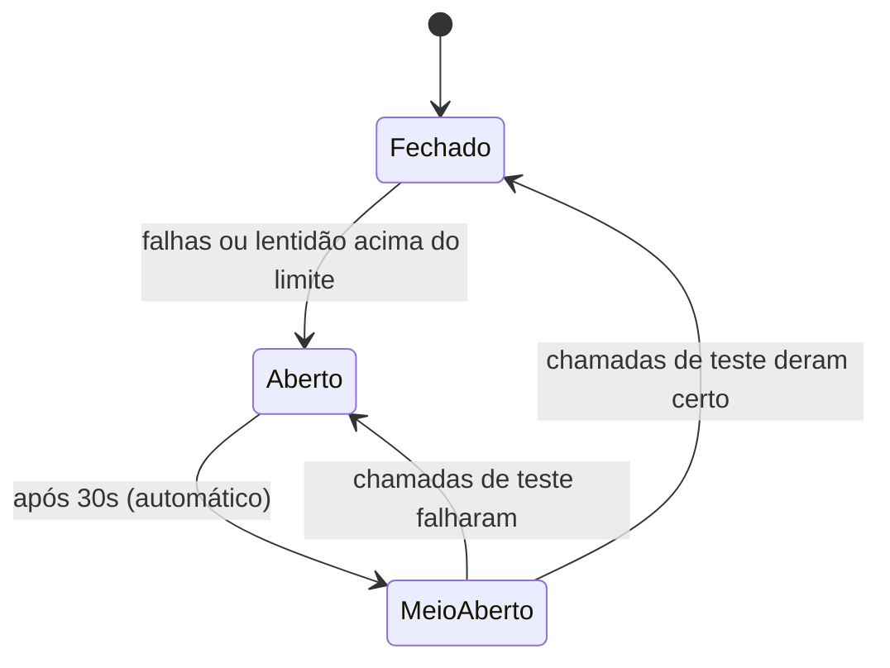

# Circuit breaker da inferência

O OpenMock protege a chamada de inferência (a classificação dos comentários de um lote) com um circuit breaker do Resilience4j, chamado `openai`. Quando a inferência falha demais, o OpenMock para de consumir a fila por um tempo, em vez de continuar reivindicando lotes que não vai conseguir processar.

Este documento explica como ele funciona, o que acontece com as mensagens e os lotes em cada situação e como configurá-lo.

## O problema que ele resolve

Para cada mensagem da fila, o OpenMock faz quatro passos:

1. Busca o lote no SocialGuard.
2. Reivindica o lote (`claim`).
3. Roda a inferência.
4. Envia os resultados ao SocialGuard.

A reivindicação vem antes da inferência. Se o provedor de inferência estiver fora do ar, todo lote consumido seria reivindicado e falharia logo em seguida. O circuit breaker detecta essa situação e interrompe o consumo, para que os lotes fiquem na fila, sem serem reivindicados, até a inferência voltar.

## Os três estados



| Estado | O que significa | Consumo da fila |
| --- | --- | --- |
| Fechado | Funcionamento normal. As chamadas passam e o resultado de cada uma é registrado. | Ligado |
| Aberto | A inferência é considerada indisponível. Nenhuma chamada é feita. | Desligado |
| Meio-aberto | Período de teste. Um número limitado de chamadas passa para verificar se a inferência voltou. | Ligado |

## Quando o circuito abre

O circuito olha para as últimas 10 chamadas de inferência (janela por contagem). Ele abre quando, nessa janela, acontece uma destas duas coisas:

- 50% ou mais das chamadas falharam.
- 50% ou mais das chamadas demoraram 30s ou mais.

A taxa só começa a ser calculada depois de 5 chamadas registradas. Antes disso o circuito nunca abre, mesmo que todas falhem.

O que conta como falha:

| Erro | Conta para abrir? | Motivo |
| --- | --- | --- |
| `InferenceUnavailableException` | Sim | O provedor de inferência falhou. |
| `PermanentBatchProcessingException` | Não | O problema está no lote (por exemplo, um comentário sem `id`), não no provedor. |

## O que acontece com o circuito aberto

1. O `InferenceCircuitListenerSwitch` recebe o evento de mudança de estado e desliga o listener do RabbitMQ.
2. A fila continua recebendo mensagens do SocialGuard. Elas ficam acumuladas, em ordem, sem ir para a fila de falhas.
3. Depois de 30s, o circuito passa sozinho para meio-aberto e o listener é religado.

Entre o circuito abrir e o listener parar de fato, ainda pode chegar uma mensagem. Para esse caso, o `BatchMessageConsumer` confere o estado do circuito logo no início, antes de falar com o SocialGuard. Se estiver aberto, a mensagem é devolvida à fila e volta para a posição original, na frente.

A passagem automática para meio-aberto é necessária aqui. Por padrão, o Resilience4j só muda de estado quando uma nova chamada chega, e com o listener desligado nenhuma chamada chegaria.

## O que acontece no meio-aberto

O listener volta a consumir e as 2 primeiras inferências servem de teste:

- Se as duas derem certo, o circuito fecha e o consumo segue normal, processando o que acumulou.
- Se uma delas falhar (o que já dá 50%), o circuito abre de novo, o listener é desligado e começa outra espera de 30s.

## O que acontece com os lotes

| Situação | Mensagem na fila | Lote no SocialGuard |
| --- | --- | --- |
| Mensagem chega com o circuito aberto | Devolvida à fila | Não é reivindicado |
| Mensagem aguardando com o listener desligado | Permanece na fila | Não é reivindicado |
| Inferência falha com o circuito fechado ou meio-aberto | Consumida | Reivindicado e marcado como falha (`POST /api/v1/batches/{id}/failure`) |
| Circuito abre entre a checagem inicial e a inferência | Consumida | Reivindicado e marcado como falha |

Ou seja: os lotes cujas falhas fazem o circuito abrir, e os lotes de teste que falham no meio-aberto, são informados ao SocialGuard como falha. Eles não voltam para a fila. Reprocessá-los é decisão do SocialGuard.

## Configuração

Os valores ficam em `application.properties`, sob `openmock.batch.inference.circuit-breaker`, e podem ser sobrescritos por variáveis de ambiente.

| Variável | Padrão | Efeito |
| --- | --- | --- |
| `INFERENCE_CB_SLIDING_WINDOW_SIZE` | `10` | Quantas chamadas recentes entram no cálculo. |
| `INFERENCE_CB_MINIMUM_NUMBER_OF_CALLS` | `5` | Mínimo de chamadas antes de a taxa ser calculada. |
| `INFERENCE_CB_FAILURE_RATE_THRESHOLD` | `50` | Percentual de falhas que abre o circuito. |
| `INFERENCE_CB_SLOW_CALL_DURATION_THRESHOLD` | `30s` | A partir de quanto tempo uma chamada é considerada lenta. |
| `INFERENCE_CB_SLOW_CALL_RATE_THRESHOLD` | `50` | Percentual de chamadas lentas que abre o circuito. |
| `INFERENCE_CB_WAIT_DURATION_IN_OPEN_STATE` | `30s` | Tempo que o circuito fica aberto antes do teste. |
| `INFERENCE_CB_PERMITTED_CALLS_IN_HALF_OPEN_STATE` | `2` | Quantas chamadas de teste passam no meio-aberto. |

## Como ver o circuito abrir

A inferência hoje é simulada e, por padrão, nunca falha. Para forçar falhas, suba o OpenMock com a taxa de falha simulada:

```sh
env INFERENCE_SIMULATED_FAILURE_RATE=1.0 ./mvnw spring-boot:run
```

Com `1.0`, toda inferência falha. Publique pelo menos 5 lotes: os 5 primeiros são reivindicados e marcados como falha, o circuito abre e os demais ficam esperando na fila. A cada 30s, 2 lotes são usados como teste, falham e o circuito abre de novo.

Para simular lentidão em vez de falha, use `INFERENCE_SIMULATED_LATENCY` com um valor igual ou maior que `INFERENCE_CB_SLOW_CALL_DURATION_THRESHOLD`.

O estado pode ser acompanhado em `/actuator/prometheus`, nas métricas `resilience4j_circuitbreaker_*` com `name="openai"`. As mais úteis são `resilience4j_circuitbreaker_state` e `resilience4j_circuitbreaker_failure_rate`.

## Onde está no código

| Arquivo | Papel |
| --- | --- |
| [InferenceCircuitBreakerConfiguration.java](src/main/java/com/unesp/OpenMock/configuration/InferenceCircuitBreakerConfiguration.java) | Cria o circuit breaker `openai` com os limites configurados e registra as métricas. |
| [BatchMessageConsumer.java](src/main/java/com/unesp/OpenMock/service/BatchMessageConsumer.java) | Confere o estado antes de reivindicar, executa a inferência por dentro do circuito e informa as falhas. |
| [InferenceCircuitListenerSwitch.java](src/main/java/com/unesp/OpenMock/service/InferenceCircuitListenerSwitch.java) | Desliga e religa o listener do RabbitMQ conforme o estado do circuito. |
| [InferenceSimulator.java](src/main/java/com/unesp/OpenMock/service/InferenceSimulator.java) | Implementação simulada da inferência, com falha e latência configuráveis. |
| [BatchProcessingProperties.java](src/main/java/com/unesp/OpenMock/configuration/BatchProcessingProperties.java) | Mapeia as propriedades de configuração. |

## Limitações conhecidas

- **A fila não tem tamanho máximo nem expiração.** Numa indisponibilidade longa, as mensagens se acumulam sem limite.
- **O circuito cobre só a inferência.** Falhas do SocialGuard são tratadas por novas tentativas (até 3) e, se persistirem, a mensagem vai para a fila `socialguard.batch.failed`. Se isso acontecer no envio dos resultados, o lote já foi reivindicado e nenhuma falha é informada, então ele fica reivindicado no SocialGuard.
- **O estado fica em memória.** Ao reiniciar o OpenMock, o circuito volta para fechado.
