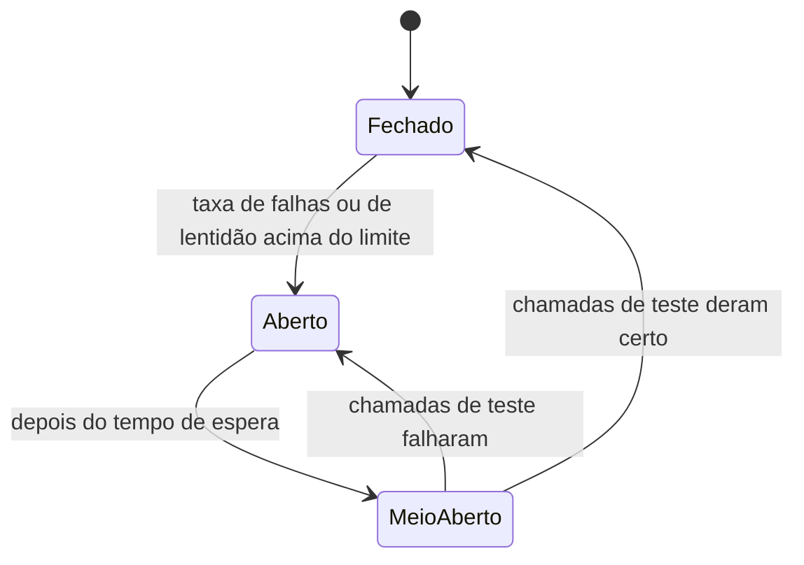
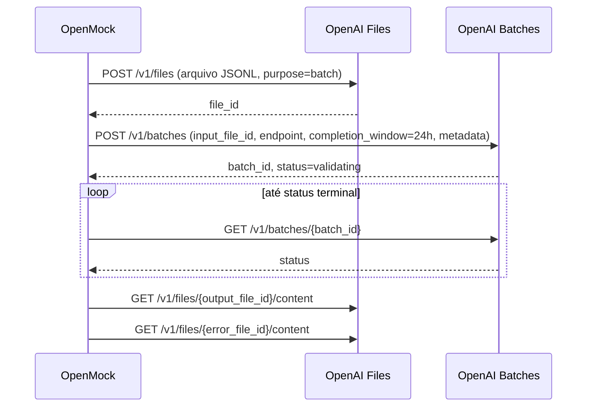

# Por que o circuit breaker da Batch API foi desenhado assim

Este documento explica **o porquê** de cada decisão do [plano de implementação](PLANO_BATCH_API_CIRCUIT_BREAKER.md) e **como funciona** cada mecanismo envolvido: a fila do RabbitMQ, o circuit breaker do Resilience4j e a Batch API da OpenAI.

O plano diz *o que* fazer. Este documento serve para quem precisa entender, revisar ou mudar uma decisão sem refazer toda a discussão.

## Sumário

**Parte 1: os mecanismos**

1. [O sistema como um todo](#1-o-sistema-como-um-todo)
2. [RabbitMQ: fila, ack, requeue e DLQ](#2-rabbitmq-fila-ack-requeue-e-dlq)
3. [O claim do SocialGuard](#3-o-claim-do-socialguard)
4. [Circuit breaker: a ideia](#4-circuit-breaker-a-ideia)
5. [Circuit breaker no Resilience4j: como ele decide](#5-circuit-breaker-no-resilience4j-como-ele-decide)
6. [O modelo de vagas (permissões) do Resilience4j](#6-o-modelo-de-vagas-permissões-do-resilience4j)
7. [Como o circuito liga e desliga o listener](#7-como-o-circuito-liga-e-desliga-o-listener)
8. [A Batch API da OpenAI](#8-a-batch-api-da-openai)
9. [Síncrono x assíncrono: por que o fluxo precisa mudar](#9-síncrono-x-assíncrono-por-que-o-fluxo-precisa-mudar)

**Parte 2: as decisões**

10. [D1: proteger cada operação HTTP, não o job](#d1-proteger-cada-operação-http-não-o-job)
11. [D2: pendentes em memória](#d2-pendentes-em-memória)
12. [D3: limite de tokens enfileirados conta como falha](#d3-limite-de-tokens-enfileirados-conta-como-falha)
13. [D4: timeout de claim fora do escopo](#d4-timeout-de-claim-fora-do-escopo)
14. [D5: o poller para com o circuito aberto](#d5-o-poller-para-com-o-circuito-aberto)
15. [D6: `expired` conta como falha](#d6-expired-conta-como-falha)
16. [D7: slow call de 30s mantido](#d7-slow-call-de-30s-mantido)
17. [D8: meio-aberto igual a hoje](#d8-meio-aberto-igual-a-hoje)
18. [Decisões de desenho derivadas](#decisões-de-desenho-derivadas)

**Parte 3: juntando tudo**

19. [Cenários passo a passo](#cenários-passo-a-passo)
20. [Decisões revisáveis e quando revisar](#decisões-revisáveis-e-quando-revisar)

---

# Parte 1: os mecanismos

## 1. O sistema como um todo

Três peças conversam entre si:

| Peça | Papel |
| --- | --- |
| **SocialGuard** | Dono dos dados. Guarda os lotes de comentários e recebe as classificações. Publica na fila o ID de cada lote que precisa ser analisado. |
| **RabbitMQ** | Fila entre os dois. Guarda os IDs dos lotes até alguém processar. |
| **OpenMock** | Processador. Pega um ID da fila, busca o lote no SocialGuard, manda classificar e devolve o resultado. |

A classificação é feita por uma IA. Hoje ela é simulada (`InferenceSimulator`). O objetivo é trocar o simulador pela Batch API da OpenAI.

O ponto mais frágil é a chamada à IA: é um serviço externo, pago, com limites de uso, que pode ficar lento ou fora do ar. O circuit breaker existe para que essa fragilidade não contamine o resto do sistema.

## 2. RabbitMQ: fila, ack, requeue e DLQ

### Fila e consumidor

O SocialGuard publica uma mensagem (o UUID do lote) no exchange `socialguard.batch`, que a encaminha para a fila `socialguard.batch.processing`. A fila é **durável**: sobrevive a um reinício do RabbitMQ.

O OpenMock tem um **listener** (`@RabbitListener` em `BatchMessageConsumer.consume`). O Spring mantém um "container" que fica conectado à fila, recebe as mensagens e chama esse método para cada uma. Esse container pode ser **parado e religado** em tempo de execução. É isso que permite pausar o consumo quando o circuito abre.

### Ack: a confirmação

Quando o RabbitMQ entrega uma mensagem, ele não a apaga na hora. A mensagem fica "em entrega" até o consumidor responder:

| Resposta | Efeito | Como acontece no OpenMock |
| --- | --- | --- |
| **Ack** | A mensagem é apagada da fila. | `consume()` termina sem exceção. |
| **Reject sem requeue** | A mensagem sai da fila. Como a fila tem *dead letter exchange*, ela vai para a fila de falhas. | Exceção comum (com `defaultRequeueRejected=false`) ou `AmqpRejectAndDontRequeueException`. |
| **Reject com requeue** | A mensagem volta para a fila, na posição original (na frente). | `ImmediateRequeueAmqpException`. |
| **Sem resposta** (o consumidor caiu) | O RabbitMQ devolve a mensagem para a fila. | Queda do processo ou da conexão. |

O ponto importante: **dar ack é dizer "não preciso mais desta mensagem"**. Depois do ack, se algo der errado, a mensagem não existe mais para ser reprocessada.

### DLQ: a fila de falhas

A fila principal é configurada com um *dead letter exchange* (`socialguard.batch.dlx`). Toda mensagem rejeitada sem requeue vai para lá e acaba na fila `socialguard.batch.failed`. Ela não se perde: fica guardada para alguém investigar.

### Retry

As chamadas ao SocialGuard são feitas por um `RetryTemplate`: até 3 tentativas, com espera crescente (1s, 2s, até 5s). Erros 4xx viram `PermanentBatchProcessingException`, que **não** é tentada de novo, porque repetir uma requisição inválida dá o mesmo resultado.

## 3. O claim do SocialGuard

Antes de processar, o OpenMock "reivindica" o lote (`POST /api/v1/batches/{id}/claim`). O SocialGuard responde `claimed: true` se o lote estava livre e agora é deste processador, ou `claimed: false` se outro já pegou.

Isso evita processamento duplicado: o RabbitMQ pode entregar a mesma mensagem duas vezes (por exemplo, depois de uma queda), e mais de uma instância do OpenMock pode estar rodando.

A consequência que importa para o circuito: **depois do claim, o lote tem dono**. Se o OpenMock reivindicar e não conseguir processar, precisa avisar o SocialGuard (`POST /failure`). Caso contrário, o lote fica preso como "em processamento". É por isso que o circuito atual já confere o estado **antes** do claim.

## 4. Circuit breaker: a ideia

O nome vem do disjuntor elétrico. Quando a corrente passa do limite, o disjuntor desarma e corta o circuito, para proteger o resto da instalação. Depois de um tempo, alguém religa e vê se o problema passou.

Em software, sem o disjuntor, quando um serviço externo cai:

- cada requisição espera o timeout inteiro, prendendo threads;
- cada tentativa falha e precisa ser tratada (aqui: reivindicar o lote e logo depois marcá-lo como falha);
- o serviço externo, que já está sobrecarregado, continua recebendo tráfego e demora mais para se recuperar.

Com o disjuntor, depois de algumas falhas o sistema **para de tentar por um tempo**, falha rápido ou espera, e de vez em quando testa se o serviço voltou.

### Os três estados



- **Fechado:** tudo passa. Cada resultado é anotado.
- **Aberto:** nada passa. Qualquer tentativa é recusada na hora, sem chamar o serviço.
- **Meio-aberto:** passa um número pequeno de chamadas de teste. O resultado delas decide se o circuito fecha ou abre de novo.

## 5. Circuit breaker no Resilience4j: como ele decide

O OpenMock usa o Resilience4j. Os parâmetros abaixo estão em `application.properties` e são lidos por `InferenceCircuitBreakerConfiguration`.

### Janela deslizante por contagem

O circuito guarda o resultado das **últimas N chamadas** (`sliding-window-size=10`). Cada chamada nova empurra a mais antiga para fora. A decisão é sempre sobre essas 10.

Existe também a janela por tempo (as chamadas dos últimos N segundos). A janela por contagem foi escolhida porque o volume de chamadas do OpenMock é baixo e irregular: numa janela por tempo, um período sem lotes deixaria a janela vazia ou com 1 ou 2 chamadas, e a taxa seria pouco confiável.

### Mínimo de chamadas

A taxa só é calculada depois de `minimum-number-of-calls=5`. Sem esse mínimo, uma única falha logo após o início seria 100% de falha e abriria o circuito.

### Taxa de falha

`failure-rate-threshold=50`: se 50% ou mais das chamadas da janela falharam, o circuito abre.

### Chamada lenta (slow call)

O circuito também mede **quanto tempo** cada chamada levou. Uma chamada que levou `slow-call-duration-threshold=30s` ou mais é "lenta", **mesmo que tenha dado certo**. Se 50% ou mais da janela for de chamadas lentas (`slow-call-rate-threshold=50`), o circuito abre.

Isso existe porque um serviço muito lento é, na prática, quase tão ruim quanto um serviço fora do ar: prende threads e atrasa tudo.

### Quais exceções contam

Por padrão, toda exceção conta como falha. Isso pode ser ajustado de dois jeitos:

- `ignoreExceptions(X)`: X não conta nem como falha nem como sucesso. A chamada simplesmente não entra na janela.
- `recordExceptions(Y)`: **só** Y conta como falha. Qualquer outra exceção conta como **sucesso** (o circuito entende que o serviço respondeu).

Hoje o projeto usa só `ignoreExceptions(PermanentBatchProcessingException)`. O plano adiciona `recordExceptions(InferenceUnavailableException)` (ver [Decisões derivadas](#decisões-de-desenho-derivadas)).

### Tempo aberto e transição automática

O circuito fica aberto por `wait-duration-in-open-state=30s`.

Detalhe importante: por padrão, o Resilience4j **não tem relógio próprio**. Ele só percebe que os 30s passaram quando chega uma nova chamada. Como o OpenMock desliga o listener com o circuito aberto, nenhuma chamada chegaria e o circuito ficaria aberto para sempre. Por isso a configuração usa `automaticTransitionFromOpenToHalfOpenEnabled(true)`: o próprio Resilience4j agenda a passagem para meio-aberto ao fim dos 30s.

### Meio-aberto

No meio-aberto passam `permitted-calls-in-half-open-state=2` chamadas. Quando as 2 terminam, o circuito calcula a taxa só sobre elas: se 50% ou mais falharam (basta uma das duas), abre de novo. Caso contrário, fecha.

### Eventos

A cada mudança de estado, o circuito publica um evento. O `InferenceCircuitListenerSwitch` escuta esses eventos (seção 7). As métricas do Prometheus (`resilience4j_circuitbreaker_*`) também vêm daí.

## 6. O modelo de vagas (permissões) do Resilience4j

Este é o mecanismo menos óbvio, e algumas decisões dependem dele.

Toda chamada protegida passa por três passos internos:

1. **Pedir permissão** (`acquirePermission`). Com o circuito fechado, sempre é concedida. Aberto, sempre é negada (`CallNotPermittedException`). Meio-aberto: concedida enquanto houver vaga (2 no nosso caso) e negada depois.
2. **Executar** a chamada, medindo o tempo.
3. **Registrar o resultado**: `onSuccess(duração)` ou `onError(duração, exceção)`. É isso que alimenta a janela. Se a chamada for abandonada sem resultado, a vaga deve ser devolvida com `releasePermission()`.

O atalho `executeSupplier(...)` faz os três passos de uma vez:

```java
circuitBreaker.executeSupplier(() -> cliente.chamar());
// = acquirePermission → chamar() medindo o tempo → onSuccess ou onError
```

O atalho resolve a maioria dos casos. Mas ele **pede a permissão no momento da chamada**, e isso cria um problema quando existe trabalho importante **antes** da chamada (no nosso caso, o claim). Os passos manuais permitem pedir a vaga antes, fazer o claim, e só depois chamar. Ver [Reservar a vaga antes do claim](#reservar-a-vaga-antes-do-claim).

**Risco dos passos manuais:** no meio-aberto, se uma vaga é pedida e nunca registrada nem devolvida, ela fica ocupada para sempre. Com as 2 vagas presas, o circuito nunca sai do meio-aberto. Por isso o plano exige `releasePermission()` em todo caminho que não chega à chamada.

## 7. Como o circuito liga e desliga o listener

O `InferenceCircuitListenerSwitch` escuta as transições de estado:

- foi para **aberto** ou **forçado aberto**: para o container do listener;
- foi para qualquer outro estado (**meio-aberto**, **fechado**): religa o container.

Por que parar o listener, em vez de só devolver as mensagens para a fila? Porque devolver com requeue faz a mensagem voltar **para a frente da fila** e ser entregue de novo na hora. O resultado seria um loop: entrega, recusa, entrega, recusa, consumindo CPU e rede durante os 30s inteiros. Com o listener parado, as mensagens simplesmente esperam na fila, em ordem.

Por que a ação roda numa thread separada: a transição para aberto acontece **dentro** da thread do listener (é ela que faz a chamada que falha). Parar o container espera as threads do listener terminarem. Se a própria thread do listener pedisse para parar, ficaria esperando por si mesma. A thread separada, única, também garante que "parar" e "religar" acontecem na ordem das transições.

Entre o circuito abrir e o listener parar de fato, ainda pode chegar uma mensagem. Para ela existe a checagem no início de `consume()`, que devolve a mensagem para a fila sem fazer o claim.

## 8. A Batch API da OpenAI

> Os detalhes desta seção foram escritos de memória. A lista do que precisa ser conferido na documentação oficial está no fim do [plano](PLANO_BATCH_API_CIRCUIT_BREAKER.md#pontos-a-confirmar-na-documentação-da-openai).

### O que é

Na API comum (síncrona), cada requisição recebe a resposta na hora. Na Batch API, você manda **um arquivo com muitas requisições** e recebe todas as respostas **depois**, num prazo de até 24h. Em troca da espera, a OpenAI cobra mais barato (cerca de metade do preço) e aplica limites de uso separados, mais altos.

Para classificar lotes de comentários, em que ninguém está esperando a resposta na tela, a troca compensa.

### O ciclo de vida



1. **Arquivo de entrada (JSONL):** uma linha por requisição. Cada linha tem um `custom_id` escolhido por nós (o id do comentário) e o corpo de uma requisição normal (modelo, mensagens).
2. **Upload** do arquivo. A OpenAI devolve um `file_id`.
3. **Criação** do batch apontando para o arquivo. A OpenAI devolve um `batch_id`. Dá para anexar `metadata` (pares chave-valor), por exemplo o UUID do lote do SocialGuard.
4. **Espera e consulta** do status.
5. **Download** dos resultados quando terminar.

### Os status

| Status | Significado | Terminal? |
| --- | --- | --- |
| `validating` | A OpenAI está conferindo o arquivo. | Não |
| `failed` | A validação falhou (arquivo inválido ou limite estourado). Nada foi processado. | Sim |
| `in_progress` | Processando. | Não |
| `finalizing` | Terminou de processar e está montando os arquivos de resultado. | Não |
| `completed` | Pronto. Resultados disponíveis. | Sim |
| `expired` | O prazo (24h) acabou antes de tudo ser processado. | Sim |
| `cancelling` / `cancelled` | Alguém cancelou. | Não / Sim |

### Os arquivos de resultado

- **`output_file`:** uma linha por requisição bem-sucedida, com o `custom_id` e a resposta.
- **`error_file`:** uma linha por requisição que falhou individualmente.

As linhas **não vêm na ordem** do arquivo de entrada. É o `custom_id` que liga cada resposta ao comentário.

### O limite de tokens enfileirados

Além dos limites comuns, a Batch API limita **quantos tokens podem estar na fila ao mesmo tempo**, por modelo. Se você submete batches demais antes de os anteriores terminarem, os novos são recusados até a fila esvaziar.

### `expired` em detalhe

O `completion_window` é o prazo que a OpenAI se dá. Normalmente ela termina muito antes. Se não terminar a tempo, o batch fica `expired`: o que já foi processado é entregue (e cobrado), e o restante volta sem resposta. Isso acontece quando a OpenAI está sem capacidade para atender toda a demanda de batches.

## 9. Síncrono x assíncrono: por que o fluxo precisa mudar

Hoje o consumidor faz tudo dentro de uma única chamada de `consume()`:

```text
recebe mensagem → busca lote → claim → classifica → envia resultado → ack
```

Com a Batch API, "classifica" pode levar horas. Manter esse formato significaria:

- **prender a thread do listener por horas**, uma por lote;
- **manter a mensagem sem ack por horas.** Se o OpenMock reiniciar nesse meio-tempo, o RabbitMQ entrega a mensagem de novo e o lote é submetido duas vezes à OpenAI (e cobrado duas vezes);
- o RabbitMQ tem um limite de tempo para o ack (`consumer_timeout`, 30 minutos por padrão em versões recentes). Passado esse tempo, ele fecha o canal.

Por isso o trabalho se divide em dois:

- **Consumidor:** busca, faz o claim, **submete** e dá ack. Termina em segundos.
- **Poller:** de tempos em tempos, **consulta** os batches pendentes e, quando algum termina, **coleta** e envia o resultado.

Como o ack acontece logo depois da submissão, a mensagem sai da fila. A partir daí, a única lembrança de que o lote está em andamento é o **registro de pendentes** do OpenMock. É por isso que a persistência desse registro importa (D2).

---

# Parte 2: as decisões

Cada decisão segue o formato: **o problema**, **as opções**, **o que foi escolhido e por quê**, **o custo**.

## D1: proteger cada operação HTTP, não o job

**Problema.** Com a Batch API, "chamar a IA" deixou de ser uma coisa só. Há um job de até 24h e várias chamadas HTTP curtas em volta dele. O circuito precisa medir alguma coisa, mas o quê?

**Opções.**

- **A) O job inteiro**, da submissão ao resultado.
- **B) Cada operação HTTP** com a OpenAI (submeter, consultar, coletar).

**Escolha: B.** O circuito responde a uma pergunta: *a OpenAI está respondendo agora?* Para responder, ele precisa de sinais rápidos e frequentes.

- Com A, cada "chamada" levaria horas. A janela de 10 chamadas cobriria dias. O circuito reagiria a uma queda muito depois de ela acontecer, e o slow call de 30s marcaria **todo** job como lento.
- Com B, uma queda da OpenAI aparece em segundos: as consultas e submissões começam a dar timeout ou 5xx.

**Como as operações foram agrupadas.** Upload e criação viraram **uma** operação (`submit`), porque uma sem a outra não serve para nada: se o upload funciona e a criação falha, o lote precisa ser marcado como falha do mesmo jeito. Os dois downloads viraram **uma** operação (`collect`) pelo mesmo motivo. A consulta (`retrieve`) é sozinha.

**Custo.** Os 30s de slow call valem para upload e criação somados. Um arquivo muito grande pode passar disso sem a OpenAI estar com problema. Com os lotes atuais isso não deve acontecer, mas vale acompanhar.

## D2: pendentes em memória

**Problema.** Depois do ack, só o OpenMock sabe que o lote X virou o batch Y na OpenAI. Esse vínculo precisa ser guardado em algum lugar.

**Opções.** Banco local, SocialGuard, `metadata` do batch da OpenAI, ou memória.

**Escolha: memória, por enquanto.** É a opção mais simples e não exige decidir nada sobre o SocialGuard ou o banco. Permite implementar e testar todo o circuito sem bloqueio.

**Custo.** Ao reiniciar o OpenMock, o registro é perdido. Os batches continuam rodando e sendo cobrados na OpenAI, mas o resultado nunca é coletado, e os lotes ficam reivindicados no SocialGuard.

**Mitigação barata já prevista.** Gravar o UUID do lote no `metadata` de cada batch. Assim, quando a persistência for implementada, ainda será possível recuperar os batches órfãos listando-os na OpenAI.

## D3: limite de tokens enfileirados conta como falha

**Problema.** Quando a fila de tokens da OpenAI enche, as submissões novas são recusadas. Isso não é uma queda: a OpenAI está funcionando, só não aceita mais trabalho agora.

**Opções.**

- Tratar à parte, com um backoff só nas submissões.
- Contar como falha do circuito.

**Escolha: contar como falha.** O efeito prático é o que se quer: **parar de submeter por um tempo**. Enquanto a fila da OpenAI estiver cheia, cada lote reivindicado e submetido falharia e seria marcado como falha. Com o circuito aberto, os lotes esperam na fila do RabbitMQ, sem ser reivindicados, até a fila da OpenAI esvaziar. Usar o mecanismo que já existe evita criar um segundo mecanismo de pausa.

**Custo.** O circuito passa a misturar dois significados, "a OpenAI caiu" e "a OpenAI está cheia". Nas métricas, os dois aparecem iguais. As exceções separadas (`EnqueuedTokenLimitExceededException`) permitem distinguir nos logs.

**Como entra no circuito.** Pode chegar de dois jeitos: erro na criação, ou batch criado que depois vai para `failed` com um código de limite. No primeiro caso o cliente lança a exceção dentro do `submit`. No segundo, a consulta vê o status e lança a exceção dentro do `retrieve` (o mesmo mecanismo do `expired`, D6).

## D4: timeout de claim fora do escopo

**Problema.** Com a Batch API, um lote pode ficar horas reivindicado. Se o SocialGuard tiver uma regra que libera lotes reivindicados há muito tempo, um lote em andamento na OpenAI poderia ser liberado, reivindicado de novo e submetido duas vezes.

**Escolha: fora do escopo.** É uma questão do SocialGuard e do fluxo como um todo, não do circuito. Fica registrada como risco.

**Por que importa para o circuito, mesmo fora do escopo.** Com o circuito aberto, o poller para (D5). Os lotes já submetidos ficam mais tempo reivindicados enquanto o circuito estiver aberto.

## D5: o poller para com o circuito aberto

**Problema.** O listener já para quando o circuito abre. E o poller?

**Opções.**

- Continuar consultando normalmente.
- Parar também.

**Escolha: parar.** As consultas também são chamadas à OpenAI. Se ela está fora do ar, elas também vão falhar, e cada falha:

- leva o tempo inteiro do timeout;
- não traz informação nova (já se sabe que a OpenAI está com problema);
- aumenta a carga num serviço que está tentando se recuperar.

Além disso, com o circuito aberto o próprio Resilience4j recusaria as chamadas (`CallNotPermittedException`). O poller conferir o estado no início do ciclo só evita o trabalho de tentar.

**Custo.** Batches que terminarem enquanto o circuito estiver aberto só são coletados depois que ele fechar ou for para meio-aberto. Como o prazo da OpenAI é de horas e a espera é de 30s, o atraso é irrelevante.

**Por que o poller confere o estado, e não é desligado como o listener.** O poller é um `@Scheduled`, que não tem um "container" para parar. Conferir o estado a cada ciclo é mais simples e tem o mesmo efeito.

## D6: `expired` conta como falha

**Problema.** Um batch `expired` significa que a OpenAI não deu conta do volume em 24h. Isso deve abrir o circuito?

**Argumentos contra contar.**

- O circuito mede se a OpenAI está respondendo **agora**. O `expired` fala de um período de até 24h atrás.
- A chamada que traz o `expired` foi uma consulta **bem-sucedida** (HTTP 200).

**Escolha: contar, por enquanto.** Um `expired` indica falta de capacidade da OpenAI. Se vários batches expiram em sequência, submeter mais só agrava o problema: vão expirar também, e os lotes vão ser cobrados parcialmente e marcados como falha. Contar o `expired` faz o circuito frear as submissões nessa situação.

**Como funciona o mecanismo.** A resposta HTTP 200 não contaria como falha. Por isso a consulta é feita assim:

```java
inferenceCircuitBreaker.executeSupplier(() -> {
    BatchStatus status = batchClient.retrieve(id);
    if (status.isExpired()) {
        throw new BatchExpiredException(...);  // sai do executeSupplier como erro
    }
    return status;
});
```

O `executeSupplier` vê a exceção sair e registra `onError`. Como `BatchExpiredException` estende `InferenceUnavailableException`, ela está na lista do `recordExceptions` e conta como falha. O poller captura a exceção do lado de fora e marca o lote como falha no SocialGuard.

**Por que esse jeito, e não `circuitBreaker.onError(...)` chamado à mão.** Chamar `onError` à mão exigiria também pedir a permissão à mão, medir o tempo e devolver a vaga em todos os caminhos. Lançar a exceção de dentro do `executeSupplier` reaproveita o atalho, que já faz tudo isso. Também deixa a regra num lugar só: o cliente da OpenAI só informa o status, e o poller decide o que conta.

**Custo.** O `expired` chega tarde. Ele pode abrir o circuito depois que a OpenAI já se recuperou, gerando uma pausa desnecessária de 30s. Por isso a decisão é marcada como provisória.

## D7: slow call de 30s mantido

**Problema.** Com a Batch API, o slow call ainda faz sentido? Com qual valor?

**Escolha: manter 30s, aplicado a cada operação.** Com D1, as operações medidas são chamadas HTTP que normalmente respondem em menos de 1 a 2 segundos. Uma consulta de status levando 30s é sinal claro de problema na OpenAI. O valor é folgado o suficiente para não disparar com uploads normais.

**Interação com o timeout de leitura.** O plano define o `read-timeout` da OpenAI em 60s, **acima** dos 30s, de propósito:

| Duração da operação | Resultado | Como o circuito conta |
| --- | --- | --- |
| Menos de 30s | Sucesso | Sucesso |
| Entre 30s e 60s | Sucesso | Chamada **lenta** |
| Mais de 60s | Timeout | **Falha** |

Se o timeout fosse menor que 30s, toda chamada demorada viraria falha antes de virar lenta, e a regra de slow call nunca seria usada.

## D8: meio-aberto igual a hoje

**Problema.** No meio-aberto, quais chamadas devem servir de teste?

**Opções.**

- **A) Igual a hoje:** o listener religa no meio-aberto. As 2 primeiras operações, sejam submissões do consumidor ou consultas do poller, são os testes.
- **B) Só consultas de status:** o listener continua desligado no meio-aberto e só religa quando o circuito fechar. Os testes são sempre consultas.

**Escolha: A.** Mantém o `InferenceCircuitListenerSwitch` sem mudança e não cria um caso especial. Na opção B, quando não houvesse batches pendentes, não haveria consulta para fazer, e o circuito ficaria preso no meio-aberto, exigindo uma consulta artificial só para testar.

**Custo.**

- Uma submissão pode ser um dos testes. Se ela falhar, o lote é reivindicado e marcado como falha (como acontece hoje).
- Consumidor e poller disputam as 2 vagas. Com muitos pendentes, as vagas tendem a ir para as consultas, e o circuito pode fechar sem ter testado nenhuma submissão.
- Mensagens que chegam com as vagas ocupadas são devolvidas para a fila e entregues de novo na hora (o loop da seção 7, em escala menor). O `requeue-delay` reduz isso.

## Decisões de desenho derivadas

Estas não foram discutidas como decisões separadas. São consequências técnicas das decisões acima.

### `recordExceptions(InferenceUnavailableException)`

**Por quê.** Hoje só a chamada `generate` do simulador fica dentro do circuito, e quase nada pode dar errado nela. Com a Batch API, passam a rodar dentro do circuito: montagem do JSONL, parsing de JSON da OpenAI, mapeamento de resultados. Um bug nosso (um `NullPointerException`, um JSON com formato inesperado) contaria como falha da OpenAI e poderia abrir o circuito, parando todo o processamento por causa de um erro de código.

Com a lista explícita, **só** `InferenceUnavailableException` e subclasses contam. O cliente da OpenAI fica responsável por traduzir as falhas reais (timeout, conexão, 5xx, 429) para essa exceção.

**Custo.** Se o cliente esquecer de traduzir algum tipo de falha real, ela não conta e o circuito não abre quando deveria. Os testes do cliente precisam cobrir cada tipo.

### Exceções como subclasses de `InferenceUnavailableException`

`BatchExpiredException` e `EnqueuedTokenLimitExceededException` estendem `InferenceUnavailableException`. Assim, contam automaticamente no circuito e são tratadas pelos mesmos `catch` que já existem. Por serem classes próprias, aparecem com nome próprio nos logs e podem ser tratadas à parte se precisar.

### Reservar a vaga antes do claim

**O problema.** Hoje:

```text
confere getState() → getBatch → claim → executeSupplier(generate)
                                           ↑ a vaga só é pedida aqui
```

Com o circuito fechado, não há diferença: a vaga sempre é concedida. No meio-aberto há só 2 vagas, e agora o poller também disputa. Sequência possível:

1. O consumidor confere o estado: meio-aberto, ok.
2. O consumidor busca o lote e faz o claim. O lote agora é dele.
3. Nesse meio-tempo, o poller ocupa as 2 vagas com consultas.
4. O consumidor pede a vaga e é recusado.
5. O lote, já reivindicado, é marcado como falha **sem nunca ter ido à OpenAI**.

**A solução.** Pedir a vaga **antes** de tudo, com `acquirePermission()`. Se não houver vaga, a mensagem volta para a fila e o lote nem é reivindicado. Se houver, ela fica reservada para este lote até a submissão.

**Por que a liberação é obrigatória.** Se o lote for duplicado (`claimed: false`) ou o SocialGuard falhar, a submissão não acontece. A vaga precisa ser devolvida com `releasePermission()`, senão fica presa (seção 6).

**Por que isso substitui a checagem de estado.** `acquirePermission()` já recusa com o circuito aberto ou forçado aberto. A checagem de `getState()` ficaria redundante.

### `requeue-delay`

**Por quê.** Com o listener ligado no meio-aberto (D8) e as 2 vagas ocupadas, cada mensagem recebida é recusada e entregue de novo na hora, num loop. Esperar 1s antes de devolver a mensagem transforma o loop em uma tentativa por segundo. A thread do listener fica parada nesse segundo, mas ela não teria nada útil para fazer.

### Poller mantém o pendente em falha temporária

Se a consulta ou o download falham por timeout ou 5xx, o batch continua na OpenAI, intacto. Não há motivo para marcar o lote como falha: basta tentar de novo no próximo ciclo. A falha já contou para o circuito, que vai abrir se ela se repetir.

O mesmo vale quando o SocialGuard falha ao receber o resultado. No consumidor de hoje, isso manda a mensagem para a DLQ. No poller não há mensagem: o registro de pendentes faz o papel da fila, e manter o item lá é o equivalente a "tentar depois".

### Poller para o ciclo ao receber `CallNotPermittedException`

Se o circuito abre no meio de um ciclo (por exemplo, as 5 primeiras consultas falham), todas as consultas seguintes seriam recusadas. Continuar o laço só geraria exceções. Parar o ciclo é mais simples e mais claro nos logs.

### `fixedDelay` no `@Scheduled`

Com `fixedRate`, o próximo ciclo começa N segundos depois do **início** do anterior. Se um ciclo demorar mais que N (várias consultas lentas), os ciclos se acumulam. Com `fixedDelay`, o próximo começa N segundos depois do **fim** do anterior, e nunca há dois ciclos ao mesmo tempo.

### Simulador mantido como padrão

O circuito precisa ser testado com falhas, lentidão e `expired`, situações difíceis de provocar na OpenAI real. O simulador gera tudo isso por configuração, sem custo e sem chave. Também permite implementar todos os passos do circuito antes de o cliente real estar pronto.

---

# Parte 3: juntando tudo

## Cenários passo a passo

### Cenário 1: funcionamento normal

1. O SocialGuard publica o UUID do lote na fila.
2. O consumidor recebe a mensagem e pede uma vaga ao circuito (fechado, concedida).
3. Busca o lote, faz o claim, submete à OpenAI (upload + criação, 2s). O circuito registra sucesso.
4. Registra o pendente e termina. O Spring dá ack. A mensagem sai da fila.
5. A cada 30s, o poller consulta o batch: `validating`, `in_progress`, `in_progress`... Cada consulta conta como sucesso.
6. Na consulta em que vem `completed`, o poller baixa os resultados, envia ao SocialGuard e remove o pendente.

### Cenário 2: a OpenAI cai

1. Circuito fechado. Uma submissão dá timeout depois de 5s de conexão. O circuito registra falha. O lote é marcado como falha no SocialGuard.
2. O poller consulta 3 pendentes: os 3 dão timeout. Mais 3 falhas. Os pendentes continuam registrados.
3. Mais uma submissão falha. Agora são 5 operações registradas (o mínimo), todas falhas: 100% ≥ 50%. **O circuito abre.**
4. O evento chega ao `InferenceCircuitListenerSwitch`, que para o listener.
5. O SocialGuard continua publicando. As mensagens se acumulam na fila, sem claim.
6. O poller, nos próximos ciclos, vê o circuito aberto e não faz nada.

### Cenário 3: a OpenAI volta

1. 30s depois de abrir, o Resilience4j passa sozinho para **meio-aberto** (transição automática).
2. O listener religa. O poller volta a rodar.
3. As 2 primeiras operações pegam as vagas. Por exemplo, o poller consulta um pendente (sucesso) e o consumidor submete um lote (sucesso).
4. As 2 de teste deram certo: **o circuito fecha**. Tudo volta ao normal, e a fila acumulada é consumida.

Se uma das duas tivesse falhado, o circuito abriria de novo e esperaria mais 30s.

### Cenário 4: mensagem chega com as vagas do meio-aberto ocupadas

1. Meio-aberto. O poller está usando as 2 vagas.
2. Chega uma mensagem. O consumidor pede vaga e é recusado.
3. O consumidor espera 1s (`requeue-delay`) e devolve a mensagem para a fila, **sem ter feito o claim**.
4. A mensagem é entregue de novo. Se o circuito já tiver fechado, segue o fluxo normal.

### Cenário 5: a OpenAI não dá conta (expired)

1. Circuito fechado. 4 lotes foram submetidos com sucesso horas atrás.
2. As consultas desses 4 vêm com `expired`. Cada uma lança `BatchExpiredException` de dentro do `executeSupplier` e conta como falha.
3. Os 4 lotes são marcados como falha no SocialGuard e saem do registro.
4. Se, junto com outras operações recentes, a janela chegar a 50% de falhas, **o circuito abre** e as submissões param por 30s.

### Cenário 6: fila de tokens da OpenAI cheia

1. Circuito fechado. Uma submissão é recusada por limite de tokens enfileirados.
2. O cliente lança `EnqueuedTokenLimitExceededException`. Conta como falha. O lote é marcado como falha.
3. As próximas submissões também são recusadas, até o circuito abrir.
4. Com o circuito aberto, os lotes ficam na fila do RabbitMQ sem claim, enquanto os batches já submetidos terminam na OpenAI e liberam espaço.
5. No meio-aberto, uma submissão de teste passa e o circuito fecha.

### Cenário 7: bug no mapeamento do resultado

1. Um batch `completed` traz uma linha num formato inesperado. O mapeamento lança `IllegalStateException` dentro do `collect`.
2. Por causa do `recordExceptions`, essa exceção conta como **sucesso** para o circuito, que não abre.
3. O poller captura a exceção e registra o erro. O pendente continua registrado e o erro se repete a cada ciclo até o bug ser corrigido. O restante do processamento segue normal.

## Decisões revisáveis e quando revisar

| Decisão | Revisar quando |
| --- | --- |
| D2 (memória) | Antes de rodar com a OpenAI real em qualquer ambiente que reinicie, porque cada reinício perde batches pagos. |
| D3 (limite de tokens no circuito) | Se o circuito abrir com frequência por limite de tokens: aí vale um controle de vazão nas submissões, em vez de pausas de 30s. |
| D6 (`expired` conta) | Se aparecerem pausas sem motivo aparente logo após a OpenAI se recuperar. |
| D7 (30s) | Se uploads de lotes grandes começarem a contar como lentos. |
| D8 (meio-aberto) | Se as métricas mostrarem o circuito fechando só com consultas de teste e reabrindo em seguida pelas submissões. Nesse caso, a alternativa é separar em dois circuitos. |
| Um circuito só | Se as consultas, baratas e quase sempre bem-sucedidas, diluírem as falhas das submissões a ponto de o circuito não abrir quando deveria. |
