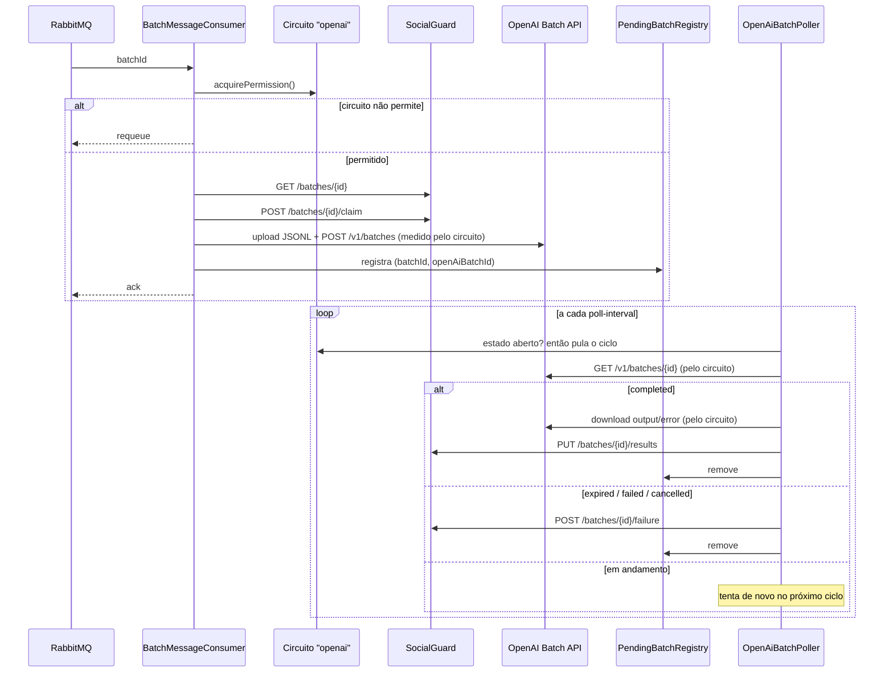

# Plano de implementação: circuit breaker para a Batch API da OpenAI

Este documento descreve como adaptar o circuit breaker `openai` do OpenMock para a inferência feita pela [Batch API da OpenAI](https://platform.openai.com/docs/guides/batch). Ele cobre as decisões já tomadas, o desenho, as mudanças arquivo por arquivo, os testes e a ordem de implementação.

O porquê de cada decisão e o funcionamento de cada mecanismo estão em [DECISOES_BATCH_API_CIRCUIT_BREAKER.md](DECISOES_BATCH_API_CIRCUIT_BREAKER.md).

O foco é o circuit breaker. O cliente HTTP da OpenAI e o mapeamento dos resultados aparecem apenas na medida necessária para o circuito funcionar. A seção [Dependências de outras partes](#dependências-de-outras-partes) lista o que precisa vir de fora.

## Sumário

1. [Decisões tomadas](#decisões-tomadas)
2. [O que muda em relação a hoje](#o-que-muda-em-relação-a-hoje)
3. [Fluxo novo](#fluxo-novo)
4. [Operações protegidas pelo circuito](#operações-protegidas-pelo-circuito)
5. [Classificação das falhas](#classificação-das-falhas)
6. [Comportamento por estado do circuito](#comportamento-por-estado-do-circuito)
7. [Mudanças por arquivo](#mudanças-por-arquivo)
8. [Configuração](#configuração)
9. [Observabilidade](#observabilidade)
10. [Testes](#testes)
11. [Ordem de implementação](#ordem-de-implementação)
12. [Dependências de outras partes](#dependências-de-outras-partes)
13. [Riscos e limitações conhecidas](#riscos-e-limitações-conhecidas)
14. [Pontos a confirmar na documentação da OpenAI](#pontos-a-confirmar-na-documentação-da-openai)

## Decisões tomadas

| # | Tema | Decisão |
| --- | --- | --- |
| D1 | O que o circuito protege | Cada operação HTTP com a Batch API da OpenAI, não o job inteiro. |
| D2 | Persistência do vínculo lote SocialGuard ↔ batch OpenAI | Fora do escopo por enquanto. Os batches pendentes ficam em memória. |
| D3 | Estouro do limite de tokens enfileirados | Conta como falha do circuito. |
| D4 | Timeout de claim no SocialGuard | Fora do escopo. |
| D5 | Poller com o circuito aberto | Para, como o listener. |
| D6 | Batch `expired` | Conta como falha do circuito e é informado ao SocialGuard como falha do lote. |
| D7 | Slow call | Mantém 30s, aplicado a cada operação protegida. |
| D8 | Meio-aberto | Igual a hoje: o listener religa e as 2 primeiras operações, sejam submissões ou consultas, servem de teste. |

## O que muda em relação a hoje

Hoje a inferência é **síncrona**. O consumidor chama `InferenceClient.generate(batch)` e recebe a classificação na hora:

```text
consume() → getBatch → claim → generate (circuito) → submitResults → ack
```

A Batch API é **assíncrona**. O resultado leva de minutos a 24h, então o consumidor não pode ficar esperando. O processamento se divide em duas partes:

```text
Consumidor:  consume() → getBatch → claim → submeter à OpenAI (circuito) → registra pendente → ack
Poller:      a cada N segundos, para cada pendente → consultar status (circuito)
             → se terminou: baixar resultado (circuito) → submitResults ou reportFailure
```

Consequências para o circuito:

- O circuito passa a ser alimentado por **dois componentes**, o consumidor e o poller, e não só pelo consumidor.
- A medição de slow call vale para cada operação HTTP, e não para o tempo até o resultado ficar pronto.
- O `expired` chega numa consulta que deu certo (HTTP 200), então precisa ser convertido em falha (ver [Classificação das falhas](#classificação-das-falhas)).

## Fluxo novo



## Operações protegidas pelo circuito

Cada operação abaixo é **uma chamada** do ponto de vista do circuito: ocupa uma posição na janela de 10 e é medida contra o limite de 30s.

| Operação | Chamadas HTTP | Quem executa |
| --- | --- | --- |
| `submit` | `POST /v1/files` (upload do JSONL) + `POST /v1/batches` | Consumidor |
| `retrieve` | `GET /v1/batches/{id}` | Poller |
| `collect` | `GET /v1/files/{output_file_id}/content` + `GET /v1/files/{error_file_id}/content`, quando existir | Poller |

Por que `submit` é uma operação só, e não duas: o upload sem a criação do batch não tem utilidade, e o consumidor precisa tratar as duas como uma unidade (as duas dão certo ou o lote é marcado como falha). Por isso o limite de 30s vale para upload e criação somados.

## Classificação das falhas

O cliente da OpenAI traduz todos os erros para duas famílias de exceção, que já existem no projeto:

| Situação | Exceção | Conta para abrir? |
| --- | --- | --- |
| Timeout de conexão ou leitura | `InferenceUnavailableException` | Sim |
| Erro de conexão (`ResourceAccessException`) | `InferenceUnavailableException` | Sim |
| HTTP 5xx | `InferenceUnavailableException` | Sim |
| HTTP 429 (rate limit) | `InferenceUnavailableException` | Sim |
| Limite de tokens enfileirados estourado (D3) | `EnqueuedTokenLimitExceededException` (nova, estende `InferenceUnavailableException`) | Sim |
| Batch com status `expired` (D6) | `BatchExpiredException` (nova, estende `InferenceUnavailableException`) | Sim |
| Operação com 30s ou mais (D7) | — (medida pelo circuito) | Sim, como slow call |
| HTTP 400, 401, 403, 404 | `PermanentBatchProcessingException` | Não |
| Batch com status `failed` por erro de validação do JSONL | `PermanentBatchProcessingException` | Não |
| Batch com status `cancelled` | `PermanentBatchProcessingException` | Não |
| Erro individual de comentário no `error_file` | — (tratado no mapeamento do resultado) | Não |
| Qualquer outra exceção (bug, NPE, erro de parsing) | — | **Não** (ver abaixo) |

### Tornar a contagem explícita

Hoje o circuito conta **qualquer** exceção, exceto `PermanentBatchProcessingException`. Com mais código rodando dentro do circuito (parsing de JSON, montagem de JSONL), um bug nosso poderia abrir o circuito como se fosse indisponibilidade da OpenAI.

Proposta: trocar para uma lista de exceções que contam.

```java
.recordExceptions(InferenceUnavailableException.class)
.ignoreExceptions(PermanentBatchProcessingException.class)
```

Com `recordExceptions`, as exceções fora da lista são tratadas como **sucesso** pelo circuito, mas continuam sendo lançadas e tratadas pelo chamador. Por isso o cliente da OpenAI precisa traduzir toda falha de rede ou de servidor para `InferenceUnavailableException`. Se uma `RestClientException` crua escapar, ela não conta.

### `expired` e limite de tokens: como viram falha

Os dois casos chegam numa resposta HTTP 200. Em vez de registrar a falha manualmente com `circuitBreaker.onError(...)`, a própria operação `retrieve` lança a exceção quando vê o status:

```java
BatchStatus status = inferenceCircuitBreaker.executeSupplier(() -> {
    BatchStatus current = batchClient.retrieve(openAiBatchId);
    if (current.isExpired()) {
        throw new BatchExpiredException(...);
    }
    if (current.isFailedByEnqueuedTokenLimit()) {
        throw new EnqueuedTokenLimitExceededException(...);
    }
    return current;
});
```

Vantagens: a contagem acontece dentro do `executeSupplier`, com a duração medida corretamente, sem chamadas manuais de `acquirePermission`/`onError` no poller. O poller captura as duas exceções e informa a falha do lote ao SocialGuard.

### Limite de tokens enfileirados: dois lugares onde pode aparecer

Dependendo de como a OpenAI reporta, o estouro pode aparecer:

1. **Na criação** (`POST /v1/batches` responde com erro): o cliente lança `EnqueuedTokenLimitExceededException` direto, dentro de `submit`.
2. **Na validação** (o batch é criado e depois vai para `failed` com um código de erro de limite de tokens): o `retrieve` lança a exceção, como no trecho acima.

O cliente deve tratar os dois. O código de erro exato precisa ser confirmado (ver [Pontos a confirmar](#pontos-a-confirmar-na-documentação-da-openai)).

## Comportamento por estado do circuito

| Estado | Listener (consumidor) | Poller |
| --- | --- | --- |
| Fechado | Ligado. Submete normalmente. | Roda a cada `poll-interval`. |
| Aberto | Desligado pelo `InferenceCircuitListenerSwitch` (sem mudança). Mensagem que chegar na janela de corrida é devolvida à fila. | Pula o ciclo inteiro sem chamar a OpenAI (D5). |
| Meio-aberto | Religado (D8). | Roda. |
| Forçado aberto | Como aberto. | Como aberto. |

### Meio-aberto com dois chamadores

No meio-aberto só 2 chamadas passam (`permittedCallsInHalfOpenState=2`). Consumidor e poller disputam essas 2 vagas: quem chegar primeiro serve de teste. As demais recebem `CallNotPermittedException`, e cada componente trata assim:

- **Consumidor:** devolve a mensagem à fila, **sem reivindicar o lote** (ver próxima seção).
- **Poller:** encerra o ciclo atual. Os pendentes não consultados ficam para o próximo ciclo.

### Reservar a vaga antes do claim

Hoje o consumidor confere `getState()` antes do claim, mas a vaga só é ocupada dentro do `executeSupplier`, depois do claim. No meio-aberto, com o poller disputando as vagas, cresce a chance de o consumidor reivindicar o lote e depois receber `CallNotPermittedException`. O lote então seria marcado como falha sem nunca ter ido à OpenAI.

Proposta: o consumidor **reserva a vaga** com `acquirePermission()` antes de falar com o SocialGuard e registra o resultado manualmente:

```java
try {
    inferenceCircuitBreaker.acquirePermission();
}
catch (CallNotPermittedException exception) {
    throw new ImmediateRequeueAmqpException("Inference circuit does not permit calls, batch " + batchId + " requeued");
}

boolean permissionUsed = false;
try {
    BatchResponse batch = retryTemplate.execute(context -> socialGuardClient.getBatch(batchId));
    if (!retryTemplate.execute(context -> socialGuardClient.claimBatch(batchId))) {
        return;
    }
    permissionUsed = true;
    long start = System.nanoTime();
    try {
        String openAiBatchId = batchClient.submit(batchId, batch);
        inferenceCircuitBreaker.onSuccess(System.nanoTime() - start, TimeUnit.NANOSECONDS);
        pendingBatches.register(batchId, openAiBatchId);
    }
    catch (RuntimeException exception) {
        inferenceCircuitBreaker.onError(System.nanoTime() - start, TimeUnit.NANOSECONDS, exception);
        throw exception;
    }
}
catch (PermanentBatchProcessingException | InferenceUnavailableException exception) {
    // reportFailure, como hoje
}
finally {
    if (!permissionUsed) {
        inferenceCircuitBreaker.releasePermission();
    }
}
```

Pontos de atenção:

- `releasePermission()` é obrigatório em toda saída que não chegou ao `submit` (lote duplicado, erro no `getBatch` ou no `claim`). Sem isso, as vagas do meio-aberto se esgotam e o circuito trava nesse estado.
- `onError` já respeita `ignoreExceptions` e `recordExceptions`: uma `PermanentBatchProcessingException` passada a ele libera a vaga sem contar como falha.
- Isso substitui a checagem `getState() == OPEN || FORCED_OPEN`, porque `acquirePermission()` já recusa nesses estados.

### Loop de requeue no meio-aberto

Com o listener ligado no meio-aberto e as 2 vagas ocupadas, toda mensagem recebida é devolvida à fila e entregue de novo imediatamente. Isso gera um loop rápido até as sondas terminarem (normalmente poucos segundos, porque as sondas são chamadas HTTP curtas).

Mitigação proposta: antes de lançar `ImmediateRequeueAmqpException` por falta de vaga, esperar `openmock.batch.inference.circuit-breaker.requeue-delay` (padrão `1s`). Isso segura a thread do listener, que de qualquer forma não teria o que fazer.

## Mudanças por arquivo

### Novos

| Arquivo | Papel |
| --- | --- |
| `service/BatchInferenceClient.java` | Interface que substitui `InferenceClient`. Operações `submit`, `retrieve`, `collect`. |
| `service/BatchStatus.java` | Record com `openAiBatchId`, `status` (enum), `outputFileId`, `errorFileId`, `errors`. Métodos `isTerminal()`, `isExpired()`, `isFailedByEnqueuedTokenLimit()`. |
| `service/OpenAiBatchStatus.java` | Enum `VALIDATING`, `FAILED`, `IN_PROGRESS`, `FINALIZING`, `COMPLETED`, `EXPIRED`, `CANCELLING`, `CANCELLED`. |
| `service/BatchExpiredException.java` | Estende `InferenceUnavailableException`. |
| `service/EnqueuedTokenLimitExceededException.java` | Estende `InferenceUnavailableException`. |
| `service/PendingBatchRegistry.java` | `ConcurrentHashMap<UUID, PendingBatch>` em memória (D2). Métodos `register`, `remove`, `snapshot`, `size`. |
| `service/OpenAiBatchPoller.java` | `@Scheduled`. Consulta os pendentes pelo circuito, coleta, envia resultado ou falha. |
| `service/SimulatedBatchInferenceClient.java` | Substitui o `InferenceSimulator`. Simula o ciclo assíncrono e as falhas, para testar o circuito sem a OpenAI. |
| `service/OpenAiBatchClient.java` | Implementação real (dependência, ver abaixo). Ativada por `openmock.batch.inference.provider=openai`. |
| `configuration/OpenAiProperties.java` | `base-url`, `api-key`, `connect-timeout`, `read-timeout`, `model`, `completion-window`. |

### Interface `BatchInferenceClient`

```java
public interface BatchInferenceClient {

    /**
     * Uploads the batch as JSONL and creates the OpenAI batch.
     * @return the OpenAI batch id
     * @throws InferenceUnavailableException when the provider fails in a way that may succeed later
     * @throws PermanentBatchProcessingException when the batch itself cannot be submitted
     */
    String submit(UUID batchId, BatchResponse batch);

    /** Reads the current status of a submitted batch. Never throws for terminal statuses. */
    BatchStatus retrieve(String openAiBatchId);

    /** Downloads and maps the results of a completed batch. */
    BatchResultsRequest collect(BatchStatus completed);
}
```

`retrieve` devolve o status sem lançar exceção. A conversão de `expired` e do limite de tokens em exceção fica no poller, dentro do `executeSupplier` (ver [Classificação das falhas](#classificação-das-falhas)). Assim a regra do circuito fica num lugar só e o cliente continua sendo só um cliente.

### Alterados

| Arquivo | Mudança |
| --- | --- |
| `OpenMockApplication.java` | Adiciona `@EnableScheduling`. |
| `service/BatchMessageConsumer.java` | Usa `BatchInferenceClient.submit`. Reserva a vaga com `acquirePermission()` antes do claim, registra sucesso ou erro manualmente e libera a vaga nas saídas sem submissão. Registra o pendente. Espera `requeue-delay` antes do requeue. |
| `configuration/InferenceCircuitBreakerConfiguration.java` | Adiciona `recordExceptions(InferenceUnavailableException.class)`. Mantém `ignoreExceptions` e a transição automática para meio-aberto. |
| `configuration/BatchProcessingProperties.java` | Adiciona `provider`, `pollInterval`, `circuitBreaker.requeueDelay` e os parâmetros do simulador (`simulatedExpiredRate`, `simulatedCompletionPolls`). |
| `service/InferenceCircuitListenerSwitch.java` | Sem mudança (D8). |
| `service/BatchContracts.java` | `CommentResponse` ganha o texto do comentário (dependência). |
| `application.properties` | Novas propriedades (ver [Configuração](#configuração)). |
| `CIRCUIT_BREAKER.md` e `Readme.md` | Atualizados com o fluxo novo. |

### Removidos

| Arquivo | Motivo |
| --- | --- |
| `service/InferenceClient.java` | Substituído por `BatchInferenceClient`. |
| `service/InferenceSimulator.java` | Substituído por `SimulatedBatchInferenceClient`. |

### `OpenAiBatchPoller` em detalhe

```java
@Scheduled(fixedDelayString = "${openmock.batch.inference.poll-interval}")
void poll() {
    State state = inferenceCircuitBreaker.getState();
    if (state == State.OPEN || state == State.FORCED_OPEN) {
        return;                                    // D5
    }
    for (PendingBatch pending : pendingBatches.snapshot()) {
        try {
            pollOne(pending);
        }
        catch (CallNotPermittedException exception) {
            return;                                // circuito abriu no meio do ciclo, ou vagas do meio-aberto esgotadas
        }
    }
}
```

`pollOne`:

1. `retrieve` dentro do circuito, com a conversão de `expired` e limite de tokens em exceção.
2. Conforme o status:

| Status | Ação | Remove do registro? |
| --- | --- | --- |
| `validating`, `in_progress`, `finalizing`, `cancelling` | Nada. | Não |
| `completed` | `collect` dentro do circuito → `submitResults` com `retryTemplate`. | Sim, depois do envio |
| `expired` | Exceção já contou no circuito → `reportFailure`. | Sim |
| `failed` por limite de tokens | Exceção já contou no circuito → `reportFailure`. | Sim |
| `failed` por outro motivo | `reportFailure` (não conta). | Sim |
| `cancelled` | `reportFailure` (não conta). | Sim |

3. Uma `InferenceUnavailableException` comum no `retrieve` ou no `collect` (timeout, 5xx) **não** remove o pendente: ele é tentado de novo no próximo ciclo. A falha já contou para o circuito.
4. Uma falha do SocialGuard no `submitResults` ou no `reportFailure` segue a regra de hoje (retry até 3 vezes). Se persistir, o pendente **não** é removido, para tentar de novo no próximo ciclo. Hoje, nesse caso, a mensagem vai para a DLQ. No poller não há mensagem, então manter o pendente é o equivalente.

Por que `fixedDelay` e não `fixedRate`: com `fixedDelay`, um ciclo lento não se sobrepõe ao próximo.

### `SimulatedBatchInferenceClient` em detalhe

Mantém o simulador como provedor padrão, para testar o circuito sem custo e sem chave da OpenAI:

- `submit`: aplica `simulated-latency` e `simulated-failure-rate` como hoje. Gera um id `sim_batch_<uuid>` e guarda o lote internamente.
- `retrieve`: devolve `in_progress` nas primeiras `simulated-completion-polls` consultas e depois `completed`. Com probabilidade `simulated-expired-rate`, devolve `expired` em vez de `completed`. Aplica latência e falha simuladas.
- `collect`: gera a classificação aleatória atual (`OK`, `SPAM`, `VIOLENT`, `SEXUAL`), tokens e modelo.

## Configuração

Novas propriedades em `application.properties`:

```properties
# Provedor de inferencia: simulator ou openai
openmock.batch.inference.provider=${INFERENCE_PROVIDER:simulator}
# Intervalo entre consultas dos batches pendentes
openmock.batch.inference.poll-interval=${INFERENCE_POLL_INTERVAL:30s}
# Espera antes de devolver a mensagem a fila quando o circuito nao permite chamadas
openmock.batch.inference.circuit-breaker.requeue-delay=${INFERENCE_CB_REQUEUE_DELAY:1s}
# Simulador
openmock.batch.inference.simulated-completion-polls=${INFERENCE_SIMULATED_COMPLETION_POLLS:2}
openmock.batch.inference.simulated-expired-rate=${INFERENCE_SIMULATED_EXPIRED_RATE:0.0}

# --- OpenAI ---
openmock.openai.base-url=${OPENAI_BASE_URL:https://api.openai.com}
openmock.openai.api-key=${OPENAI_API_KEY:}
openmock.openai.connect-timeout=${OPENAI_CONNECT_TIMEOUT:5s}
openmock.openai.read-timeout=${OPENAI_READ_TIMEOUT:60s}
openmock.openai.model=${OPENAI_MODEL:gpt-4o-mini}
openmock.openai.completion-window=${OPENAI_COMPLETION_WINDOW:24h}
```

As propriedades do circuito existentes continuam iguais (D7: slow call de 30s mantido).

### Timeout de leitura e slow call

O `read-timeout` da OpenAI (60s) fica **acima** do limite de slow call (30s) de propósito:

- Uma operação entre 30s e 60s termina e é contada como **lenta**.
- Uma operação acima de 60s estoura o timeout e é contada como **falha**.

Se o `read-timeout` fosse menor que 30s, nenhuma chamada chegaria a ser lenta e a regra de slow call nunca seria acionada.

A `api-key` nunca deve ir para o repositório. Ela só é lida da variável de ambiente.

## Observabilidade

As métricas do circuito continuam em `/actuator/prometheus` (`resilience4j_circuitbreaker_*`, `name="openai"`). Novas métricas:

| Métrica | Tipo | Para quê |
| --- | --- | --- |
| `openmock_openai_batches_pending` | Gauge (`PendingBatchRegistry.size()`) | Ver os pendentes acumulando enquanto o circuito está aberto. |
| `openmock_openai_batches_finished_total{status=...}` | Counter | Quantos batches terminaram em `completed`, `expired`, `failed`, `cancelled`. |
| `openmock_openai_batch_duration_seconds` | Timer (da submissão ao status terminal) | Acompanhar quanto a OpenAI está demorando. Útil para entender `expired`. |

Logs (nível `INFO`): submissão (`batchId`, `openAiBatchId`), status terminal, ciclo do poller pulado por circuito aberto (nível `DEBUG`, para não poluir).

## Testes

Seguem o estilo atual: testes de unidade com `CircuitBreaker.of(...)` configurado no próprio teste, mocks do Mockito e `new RetryTemplate()`.

### `InferenceCircuitBreakerConfigurationTest` (ajustar)

- [ ] Mantém todos os testes atuais.
- [ ] `countsBatchExpiredAsFailure`
- [ ] `countsEnqueuedTokenLimitAsFailure`
- [ ] `doesNotCountUnexpectedExceptionsAsProviderFailures` (por exemplo, `IllegalStateException`), depois do `recordExceptions`.

### `BatchMessageConsumerTest` (reescrever as partes de inferência)

- [ ] `submitsToOpenAiAndRegistersPendingBatchAfterClaim`
- [ ] `acknowledgesWithoutSubmittingResultsToSocialGuard` (o `submitResults` agora é do poller)
- [ ] `requeuesWithoutCallingSocialGuardWhenTheCircuitIsOpen`
- [ ] `requeuesWithoutCallingSocialGuardWhenTheCircuitIsForcedOpen`
- [ ] `requeuesWithoutClaimingWhenHalfOpenPermitsAreTaken`: ocupa as 2 vagas, envia a mensagem, verifica que `claimBatch` não foi chamado.
- [ ] `releasesPermissionWhenTheBatchIsADuplicate`: no meio-aberto, `claim` devolve `false` e a vaga volta a ficar disponível.
- [ ] `releasesPermissionWhenSocialGuardFails`
- [ ] `reportsSubmitFailureAndCountsItAgainstTheCircuit`
- [ ] `reportsPermanentSubmitErrorWithoutCountingIt`
- [ ] `countsEnqueuedTokenLimitOnSubmitAsFailure`
- [ ] `countsSlowSubmitAsSlowCall`
- [ ] `waitsTheRequeueDelayBeforeRequeueing`
- [ ] Mantém: identificadores inválidos, espaços em volta do UUID, falhas do SocialGuard não contam.

### `OpenAiBatchPollerTest` (novo)

- [ ] `skipsTheCycleWhenTheCircuitIsOpen` (sem nenhuma chamada ao cliente)
- [ ] `skipsTheCycleWhenTheCircuitIsForcedOpen`
- [ ] `keepsInProgressBatchesPending`
- [ ] `submitsResultsAndRemovesCompletedBatch`
- [ ] `reportsExpiredBatchAndCountsItAgainstTheCircuit`
- [ ] `reportsTokenLimitFailedBatchAndCountsIt`
- [ ] `reportsValidationFailedBatchWithoutCountingIt`
- [ ] `reportsCancelledBatchWithoutCountingIt`
- [ ] `keepsBatchPendingWhenRetrieveFailsAndCountsIt`
- [ ] `keepsBatchPendingWhenCollectFails`
- [ ] `keepsBatchPendingWhenSocialGuardFails`
- [ ] `stopsTheCycleWhenTheCircuitOpensMidway`: 5 pendentes, falhas abrem o circuito no 5º, nenhum outro é consultado no mesmo ciclo.
- [ ] `stopsTheCycleWhenHalfOpenPermitsAreExhausted`
- [ ] `closesTheCircuitWhenHalfOpenStatusChecksSucceed`

### `SimulatedBatchInferenceClientTest` (substitui `InferenceSimulatorTest`)

- [ ] Rejeita configuração inválida (taxas fora de 0 a 1, `completion-polls` negativo).
- [ ] Fica `in_progress` pelo número configurado de consultas e depois `completed`.
- [ ] Devolve `expired` com `simulated-expired-rate=1.0`.
- [ ] Falha `submit` e `retrieve` com `simulated-failure-rate=1.0`.
- [ ] `collect` classifica todos os comentários e soma tokens dentro do intervalo.

### `InferenceCircuitListenerSwitchTest`

- [ ] Sem mudança.

### Teste de ponta a ponta manual

Com o simulador:

```sh
env INFERENCE_SIMULATED_FAILURE_RATE=1.0 ./mvnw spring-boot:run
```

1. Publique 5 lotes. Os 5 são reivindicados, a submissão falha, são marcados como falha e o circuito abre.
2. Publique mais lotes. Eles ficam na fila.
3. Em `/actuator/prometheus`, `resilience4j_circuitbreaker_state{name="openai",state="open"}` fica em `1`.
4. Após 30s, o circuito vai para meio-aberto, 2 lotes são testados, falham e o circuito abre de novo.

Para o `expired`:

```sh
env INFERENCE_SIMULATED_EXPIRED_RATE=1.0 INFERENCE_POLL_INTERVAL=2s ./mvnw spring-boot:run
```

Publique 5 lotes. Eles são submetidos com sucesso e ficam pendentes. Nos ciclos seguintes, todos expiram, são informados como falha e o circuito abre. Por causa das submissões bem-sucedidas na janela, a taxa de falha precisa chegar a 50% das últimas 10 operações.

## Ordem de implementação

Cada passo compila, passa nos testes e pode virar um commit.

| Passo | Conteúdo | Depende de |
| --- | --- | --- |
| 1 | Exceções novas (`BatchExpiredException`, `EnqueuedTokenLimitExceededException`) e `recordExceptions` na configuração do circuito. Testes de configuração. | — |
| 2 | `BatchInferenceClient`, `BatchStatus`, `OpenAiBatchStatus`. `SimulatedBatchInferenceClient` com testes. Remove `InferenceClient` e `InferenceSimulator`. | 1 |
| 3 | `PendingBatchRegistry`. Consumidor passa a usar `submit`, com `acquirePermission`/`onSuccess`/`onError`/`releasePermission` e `requeue-delay`. Testes do consumidor. | 2 |
| 4 | `@EnableScheduling` e `OpenAiBatchPoller` com testes. | 3 |
| 5 | Métricas novas e logs. | 4 |
| 6 | Atualização de `CIRCUIT_BREAKER.md` e `Readme.md`. Teste manual de ponta a ponta com o simulador. | 5 |
| 7 | `OpenAiBatchClient` com a classificação de erros desta seção, assim que a parte do cliente estiver pronta. | 6 e dependências |

Os passos 1 a 6 não dependem da OpenAI real e podem ser feitos e revisados só com o simulador.

## Dependências de outras partes

O circuito não precisa disso para ser implementado e testado com o simulador, mas a integração real precisa:

1. **Texto dos comentários.** Hoje `CommentResponse` só tem o `id`, e o texto enviado pelo SocialGuard é descartado. Sem o texto não há o que enviar à OpenAI. É preciso confirmar o nome do campo na API do SocialGuard.
2. **Prompt e formato da resposta.** Como pedir à OpenAI uma das 4 categorias por comentário e como ler a resposta (saída estruturada em JSON, por exemplo).
3. **Erros por comentário no `error_file`.** O que fazer quando parte dos comentários de um batch `completed` falha: informar o lote inteiro como falha, ou enviar resultado parcial. Não afeta o circuito.
4. **Cliente HTTP da OpenAI** (`OpenAiBatchClient`). Precisa cumprir a tabela de [Classificação das falhas](#classificação-das-falhas): traduzir **toda** falha de rede, 5xx, 429 e limite de tokens para `InferenceUnavailableException` (ou subclasse), e 4xx para `PermanentBatchProcessingException`.

## Riscos e limitações conhecidas

- **Pendentes em memória (D2).** Ao reiniciar o OpenMock, os batches pendentes são perdidos: continuam rodando na OpenAI (e sendo cobrados), mas o resultado nunca chega ao SocialGuard, e os lotes ficam reivindicados para sempre. O `metadata` do batch da OpenAI pode guardar o `batchId` do SocialGuard desde já, para facilitar a recuperação quando a persistência for implementada.
- **Mais de uma instância do OpenMock.** Cada instância tem o seu próprio circuito e o seu próprio registro de pendentes. Funciona, porque cada uma só consulta o que submeteu, mas uma instância pode abrir o circuito enquanto a outra continua chamando a OpenAI.
- **`expired` conta tarde (D6).** Um `expired` diz respeito a um batch submetido até 24h antes. Ele pode abrir o circuito depois que a OpenAI já se recuperou. Fica registrado como decisão provisória ("por enquanto").
- **Mistura de operações na janela.** Submissões, consultas e coletas dividem a mesma janela de 10. Com muitos pendentes, as consultas (baratas e quase sempre bem-sucedidas) podem diluir a taxa de falha das submissões. Se isso atrapalhar, a alternativa é separar em dois circuitos (`openai-submit` e `openai-poll`).
- **Meio-aberto disputado.** Com o poller rodando, as 2 vagas do meio-aberto podem ser ocupadas só por consultas de status. Isso é aceitável (D8), mas significa que o circuito pode fechar sem nenhuma submissão ter sido testada.
- **Loop curto de requeue no meio-aberto.** Mitigado com `requeue-delay`.
- **Timeout de claim no SocialGuard (D4).** Fora do escopo, mas com a Batch API um lote pode ficar horas reivindicado.

## Pontos a confirmar na documentação da OpenAI

Estes detalhes foram escritos de memória e precisam ser conferidos antes do passo 7:

- [ ] Lista exata de status do batch (`validating`, `failed`, `in_progress`, `finalizing`, `completed`, `expired`, `cancelling`, `cancelled`).
- [ ] Como o limite de tokens enfileirados é reportado: erro HTTP na criação, batch `failed` com código em `errors.data[].code`, ou os dois. Qual é o código exato.
- [ ] Como as requisições não concluídas de um batch `expired` aparecem: no `error_file`, no `output_file` ou em nenhum dos dois.
- [ ] Formato de cada linha do `output_file` e do `error_file` (`custom_id`, `response.status_code`, `response.body`, `error`).
- [ ] Valores aceitos para `completion_window`.
- [ ] Limites do `metadata` do batch (quantidade de chaves e tamanho).
